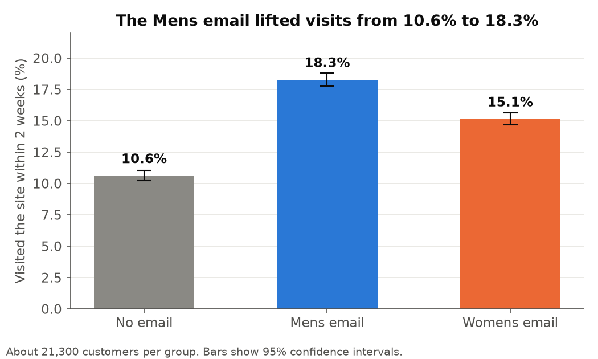
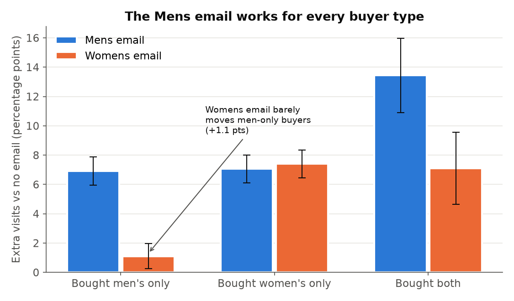
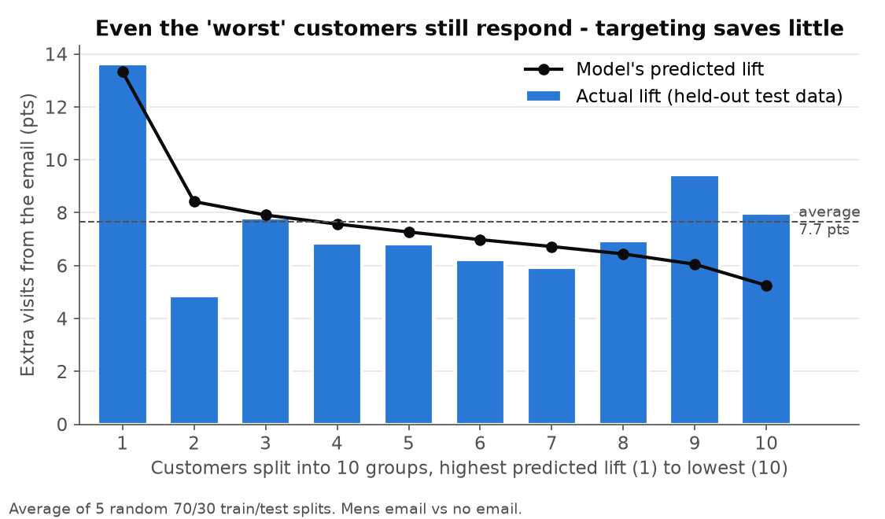

# Email campaign test: did it work, for whom, and should we target?

A retailer emailed 64,000 recent customers. It split them at random into three groups:

- 21,307 got an email about **men's** products
- 21,387 got an email about **women's** products
- 21,306 got **no email** (the control group)

Then it tracked two weeks of site visits, orders and spend.

I answered three questions a marketing team would ask:

1. Did the emails work, and how much money did they bring in?
2. Which email is better, and does that change by customer?
3. Could we email fewer people and keep most of the gain?

**Short answer:** send the Mens email to everyone. It beat both other options. And a model that picks "the best people to email" keeps about half the gain when you email half the people, which is about what random picking would do. So targeting is not worth it for this campaign.

## Data

Real data, not synthetic. It is the public MineThatData E-Mail Analytics Challenge dataset (Kevin Hillstrom, 2008). Raw file: `data/raw/hillstrom.csv`, 64,000 rows, 12 columns. Download link if you need it again:
http://www.minethatdata.com/Kevin_Hillstrom_MineThatData_E-MailAnalytics_DataMiningChallenge_2008.03.20.csv

Columns I used: months since last purchase, dollars spent last year, whether they bought men's / women's items, new customer or not, area (urban / suburban / rural), channel (phone / web / both), and the outcomes: visit, conversion (bought), spend.

Things I found while checking it:
- "Suburban" is spelled "Surburban" in the raw file. Fixed in SQL.
- There is no customer id. 6,562 rows are exact copies of another row. I kept them, because two customers can have the same values and there is no way to tell.
- Only 578 people bought anything (0.9%). So spend is mostly zeros. This is why the spend results have wide confidence intervals.

## How it runs

```
python3 -m venv .venv && . .venv/bin/activate
pip install -r requirements.txt
./run_all.sh
```

| Step | File | What it does |
|---|---|---|
| 1 | `sql/01_load_clean.sql`, `sql/02_checks.sql`, `sql/03_summary.sql`, `src/01_build_db.py` | Loads the CSV into DuckDB, cleans it, runs 8 data checks, checks the random split was fair |
| 2 | `src/02_ab_test.py` | The A/B test: lift, 95% CIs, p-values, extra revenue, regression, split by customer type |
| 3 | `src/03_uplift_model.py` | Uplift model (two-model approach) with logistic regression and gradient boosting, tested on 5 train/test splits |
| 4 | `src/04_charts.py` | The 3 charts below |

All result tables go to `outputs/` as CSV. Those files are also the data source for the Tableau dashboard (see the end of this file).

## Step 1: can I trust the test?

Before looking at results, I checked the test itself.

- **Data checks:** 8 checks in SQL (row count, missing values, "bought but never visited", "spent money but no order", etc.). All 8 pass.
- **Sample ratio check:** the groups should be about equal in size. Chi-square test p = 0.90, so the split looks fine. (If this failed, something went wrong with who got which email, and I would stop.)
- **Balance check:** random groups should look the same before the email. I compared 7 features. The biggest standardized mean difference is 0.011. The normal bar is 0.1. So the groups match.

## Step 2: the A/B test



| | No email | Mens email | Womens email |
|---|---|---|---|
| Visit rate | 10.6% | 18.3% | 15.1% |
| Conversion rate | 0.57% | 1.25% | 0.88% |
| Spend per customer | $0.65 | $1.42 | $1.08 |

Mens email vs no email:
- Visits: **+7.7 points** (95% CI 7.0 to 8.3), a 72% relative lift
- Orders: +0.68 points (95% CI 0.50 to 0.86), more than double
- Spend: +$0.77 per customer (bootstrap 95% CI $0.48 to $1.05)
- **Extra revenue: about $16,400** in two weeks from 21,307 emails (95% CI $10,500 to $22,700)

The Womens email also worked, but less: +4.5 visit points and about $9,100 extra revenue (95% CI $3,900 to $14,400).

Mens vs Womens email, head to head:
- Visits: Mens wins by 3.1 points (p < 0.0001)
- Orders: Mens wins by 0.37 points (p = 0.0002)
- Spend: Mens is ahead by $0.35 per customer, but p = 0.03. That does not pass my Bonferroni cut-off. So I say the Mens email is **likely** better on spend, not proven.

Methods, and why:
- Two-proportion z-test for visits and orders (they are yes/no outcomes).
- Welch t-test plus a bootstrap CI (2,000 resamples) for spend, because spend is 99% zeros with a few big orders. I did not want to rely only on the normal-curve formula.
- Bonferroni correction. I ran 9 tests (3 comparisons x 3 metrics), so each one needs p < 0.05 / 9 = 0.0056. This stops me from "finding" a win by running lots of tests.
- Regression with pre-email features (recency, past spend, etc.) as a second check. The Mens email estimate moved from 0.0766 to 0.0761. That is what you expect in a clean random test. The standard error only shrank by about 1.5%, because these features don't predict visits very well.

### For whom?



This is the most useful finding. The Womens email adds only **+1.1 visit points** for people who bought only men's items last year. The Mens email adds +6.9 points for the same people. An interaction test says this gap is real (-6.2 points, 95% CI -7.5 to -5.0, p < 0.001).

The Mens email works about as well as the Womens email even for women-only buyers (+7.1 vs +7.4 points). So there is no group where the Womens email clearly wins.

**Recommendation:** send the Mens email to all customers. Compared with sending the Womens email to a third of them, that is about 670 more visits per campaign. On revenue, the extra is likely positive (roughly $700 to $13,700 per campaign), but the spend difference was not significant after correction, so I would present the visit number as the main one.

## Step 3: should we target?

Emails are cheap, but sending fewer of them still matters (unsubscribes, spam complaints, customer fatigue). So I asked: is there a small group of customers that gives most of the lift?

I built an **uplift model** using the two-model approach:
- Model A learns P(visit) from customers who got the Mens email.
- Model B learns P(visit) from customers who got no email.
- Predicted uplift for a customer = Model A - Model B.

Then I sorted held-out test customers by predicted uplift and checked the *actual* lift in each group. This works because inside any group, the email was still assigned at random. I repeated it on 5 different random 70/30 splits so one lucky split can't fool me.



If we only email the top X% by predicted uplift, how much of the extra visits do we keep?

| Email only the top... | Logistic regression keeps | Gradient boosting keeps | Random picking keeps |
|---|---|---|---|
| 30% | 35% (range 31-42%) | 34% (28-39%) | 30% |
| 50% | 53% (47-59%) | 52% (49-57%) | 50% |

So the model is only a little better than random. The top 10% really do respond more (about 13.6 points vs 7.7 on average). But the bottom 10% still respond at about 8 points, and the model was wrong about them (it predicted 5). In plain words: **almost everyone responds to this email about the same.** Cutting the list in half would throw away almost half the gain.

One more thing I checked: a normal "who is most likely to visit" model (AUC 0.62) did about as well as the uplift model here (keeps 57% at 50%). That is a warning sign, not a win. It means the model mostly finds people who visit a lot anyway, and in this data those people also respond a bit more. In other campaigns this can go the other way, which is why I tested the uplift model directly instead of trusting a normal response model.

**Recommendation:** don't target this campaign. Email everyone with the Mens email. Only reconsider if email costs or unsubscribe rates become large.

## What this project does NOT do

- **Revenue, not profit.** The data has no margin or email cost numbers, so I report revenue.
- **Two weeks only.** I can't see if the email just moved purchases earlier, or if it had a longer effect.
- **One campaign, 2008.** Email behaviour has changed. The method carries over; the exact numbers may not.
- **578 buyers total.** Anything about spend or orders is less certain than visits. I say so wherever it matters.
- **No R, cloud, NLP or forecasting.** Those are covered in other projects.

## Dashboard (Tableau Public)

Not built yet. The inputs are ready in `outputs/`:
- `arm_summary.csv` - KPI tiles (visit rate, conversion, revenue per group)
- `lift_by_buyer_type.csv` - bar chart with a filter for metric (visit / spend)
- `uplift_by_decile.csv` - predicted vs actual lift by decile, filter by model
- `extra_revenue.csv` - revenue tile with CI

Plan: one page, KPI row at the top, buyer-type chart in the middle, decile chart at the bottom, one "metric" filter.

## Tools

Python (pandas, NumPy, SciPy, statsmodels, scikit-learn, matplotlib), SQL (DuckDB), Git. Tableau for the dashboard.
